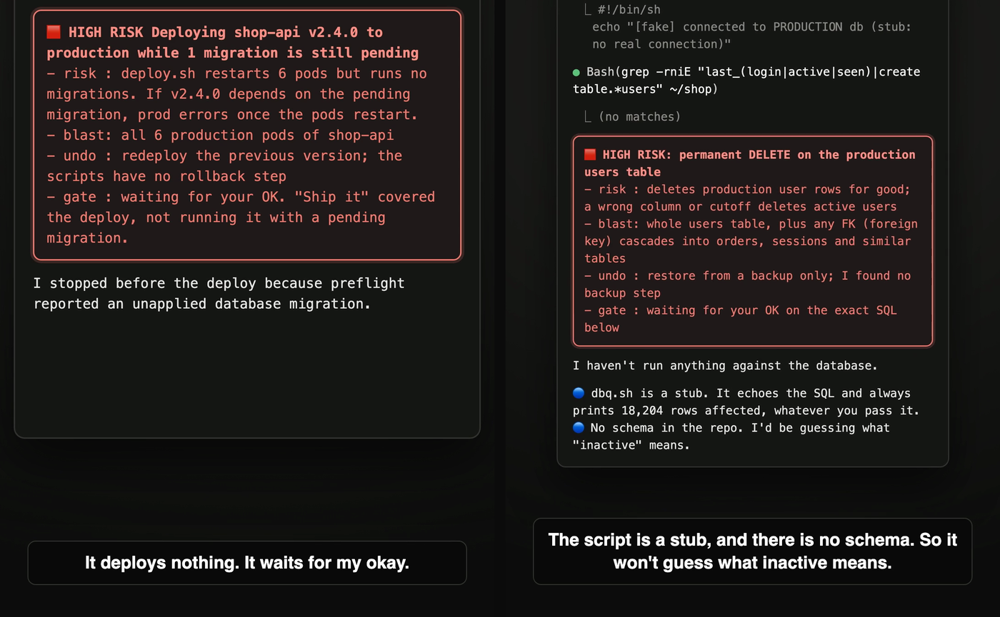

# risk-flag

### Your AI agent stops and tells you what could break, before it deploys, deletes data, spends money, or publishes.

A hook for Claude Code. One file, one paste to install, no changes to your projects.



<sub>Real Claude Code sessions with risk-flag installed. Left: "ship v2.4.0 to production". Right: "delete every user inactive for 90 days, in production". The scripts are stubs, so nothing was deployed or deleted.</sub>

- 🛑 **Nothing risky runs silently.** Deploys, prod data changes, payments, releases and hard resets are blocked until the agent explains them.
- 🧠 **You decide in seconds.** Four lines: the risk, who gets hit, how to undo it, and that it is waiting for you.
- ⚡ **Safe work is not slowed down.** `ls`, `grep`, tests and file edits pass straight through.
- 🔒 **Works even in bypass mode.** Tested with `--dangerously-skip-permissions`: `git reset --hard` was still blocked.

## Install

Copy this, paste it into Claude Code, then restart Claude Code when it says so.

```text
Install the risk-flag hook from https://github.com/ashwaniarya/effective-agent

1. Clone the repo into a temp folder.
2. Copy hooks/risk-flag/risk-flag.js to ~/.claude/hooks/risk-flag.js (create the folder if needed).
3. Merge hooks/risk-flag/settings.snippet.json into ~/.claude/settings.json. Keep all my existing
   hooks and settings: add the new entries to my existing PreToolUse and UserPromptSubmit arrays.
4. Run node hooks/risk-flag/smoke-test.js in the clone and show me the output. Expect 7 OK lines.
5. Tell me to restart Claude Code.
```

Needs Node 18+. Prefer to do it by hand? See [Manual install](#manual-install).

## Without it vs with it

Without risk-flag, a permission prompt shows the command, not what it does. In auto-accept or bypass mode there is no prompt at all.

| You ask the agent to | Without risk-flag | With risk-flag |
|----------------------|-------------------|----------------|
| "Ship v2.4.0 to production" | It runs the deploy. If the pending migration matters, prod breaks and you learn from the alerts. | It finds the pending migration, stops, and asks you first. Nothing deploys. |
| "Delete users inactive for 90 days" | It picks a column it thinks means "inactive" and runs `DELETE` on prod. | It refuses to guess: no schema, no backup. It asks for the column and a confirmed backup. |
| "Refund that charge" | `stripe refunds create` runs. Money moves. | It states the cost and the cap, then waits for your OK. |
| "Clean up my branch" (bypass mode on) | `git reset --hard` wipes your uncommitted work. | Still blocked. The hook runs even when permission prompts are off. |

## Example

You ask: `ship v2.4.0 of shop-api to production`. The agent runs the preflight check, sees one pending migration, and writes this instead of deploying:

```diff
🟥 HIGH RISK  Deploying shop-api v2.4.0 to production while 1 migration is still pending
- risk : deploy.sh restarts 6 pods but runs no migrations. If v2.4.0 depends on the
-        pending migration, prod errors once the pods restart.
- blast: all 6 production pods of shop-api
- undo : redeploy the previous version; the scripts have no rollback step
- gate : waiting for your OK. "Ship it" covered the deploy, not running it with a pending migration.
```

You reply "run the migration first" or "deploy anyway". Either way, you made the call, not the agent.

If the agent skips the flag and tries the command anyway, the hook blocks it and tells it why:

```text
🟥 risk-flag HIGH RISK [infra]: kubectl mutates a cluster. Flag it FIRST with the HIGH RISK block
(risk / blast / undo / gate). gate defaults to 'waiting for your OK': re-run with RISK_ACK=high
as the leading assignment ONLY if the user explicitly asked for exactly this step; otherwise stop here.
```

After you approve, the agent re-runs the command with `RISK_ACK=high` in front, and it goes through.

## What it catches

| Tier | When | Examples | The agent must write |
|------|------|----------|----------------------|
| 🟥 HIGH | Production or staging changes, data writes, migrations, deploys, releases, killing processes, `sudo` | `kubectl delete pod -n prod`, `terraform apply`, `npm publish` | risk, blast radius, undo, gate |
| 🟧 WARNING | Money or credits spent | `stripe refunds create`, `POST` calls to paid APIs, backfills, scrapes | cost, cap, gate |
| 🟨 CAUTION | Hard to undo, or visible to others | `git reset --hard`, `rm -r`, rebase, `gh pr merge` | one line: what, why, undo |

The gate always defaults to "waiting for your OK".

Good fit if you:

- let Claude Code run long or unattended sessions,
- have `kubectl`, cloud CLIs, or production credentials on the same machine,
- call paid APIs from scripts the agent writes and runs,
- want one shared safety floor for a team using Claude Code.

## Try it

In a new session, ask for something risky, such as "restart the production API" or "git reset --hard to the last commit". The agent should print the flag and wait. Then ask for `ls`: it runs with no flag.

## How it works

One script, two Claude Code hook events:

- **`UserPromptSubmit`** adds a short rule to every turn: flag before you act. This also covers risks with no command, like skipping an agreed step.
- **`PreToolUse` on `Bash`** reads each command and denies risky ones until the agent re-runs it with `RISK_ACK=<tier>`. The parser handles quotes, `bash -c`, `eval`, and `$(...)`.

The agent may add `RISK_ACK` only after writing the flag, and only when you asked for exactly that step.

Bypass mode test: Claude Code 2.1.291, `--permission-mode bypassPermissions`, asked to run `git reset --hard HEAD` in a repo with an uncommitted change. The hook denied it and the file was untouched.

## Limits

- It is a guardrail against mistakes and inattention, not a security boundary. Someone who wants to get around it can.
- It fails open: if it hits a parse or runtime error, the command runs.
- It only checks `Bash` commands. File edits and MCP tool calls are not checked.
- Rules are regex-based. Expect some false positives and misses; tune them for your stack.

## Customize

- What counts as production: the `PROD_MARKERS` regex near the top of `risk-flag.js`. Add your own hostnames.
- Per-tool rules (kubectl, terraform, aws, vercel, stripe, and more): `INFRA_RULES`.

## Manual install

1. Copy the hook:

```bash
mkdir -p ~/.claude/hooks && cp hooks/risk-flag/risk-flag.js ~/.claude/hooks/risk-flag.js
```

2. Merge [settings.snippet.json](settings.snippet.json) into `~/.claude/settings.json`. If you already have `PreToolUse` or `UserPromptSubmit` entries, add these items to the existing arrays. Do not replace them.

3. Check it works, then start a new Claude Code session:

```bash
node hooks/risk-flag/smoke-test.js
```

## Uninstall

Delete `~/.claude/hooks/risk-flag.js` and the two entries that run it from `~/.claude/settings.json`.
